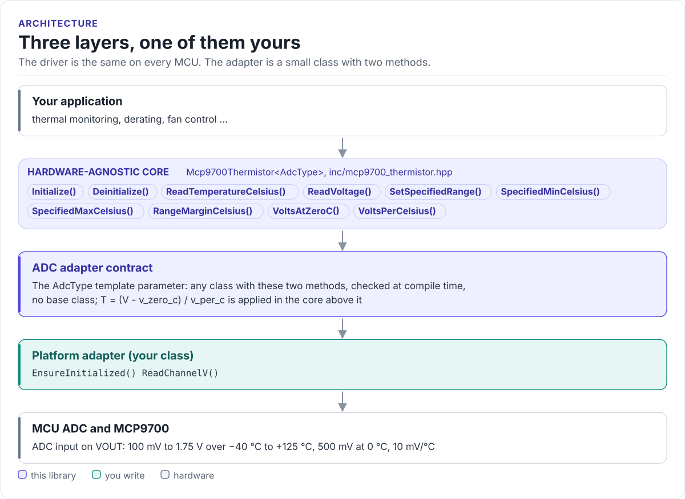

# MCP9700 Driver

A C++17 driver for the Microchip MCP9700, MCP9700A and MCP9700B linear active thermistors: read the analog output
through any MCU's ADC and get degrees Celsius, with the datasheet coefficients or your own calibration.

[](https://github.com/hardfoc/hf-mcp9700-driver/actions/workflows/ci-host-tests.yml)
[](https://github.com/hardfoc/hf-mcp9700-driver/actions/workflows/esp32-examples-build-ci.yml)
[](https://hardfoc.github.io/hf-mcp9700-driver/)
[](LICENSE)

**Documentation: <https://hardfoc.github.io/hf-mcp9700-driver/>**

<!-- figure: driver-layers -->
<picture>
  <source media="(prefers-color-scheme: dark)" srcset="docs/diagrams/driver-layers.dark.svg">
  
</picture>
<!-- /figure -->

## In 30 seconds

Write a small ADC adapter for your MCU (bring the ADC up, return volts at the sensor pin;
[Porting](https://hardfoc.github.io/hf-mcp9700-driver/latest/porting/)), then:

<!-- generated: quickstart-code -->
```cpp
#include "mcp9700_thermistor.hpp"

int print_board_temperature(MyAdc& adc) {
  hf::mcp9700::Mcp9700Thermistor<MyAdc> sensor(&adc, /*adc_channel=*/0);  // 500 mV at 0 °C, 10 mV/°C

  if (!sensor.Initialize()) {                     // 1. brings the ADC up
    return -1;                                    // adapter failed: ADC unit, channel, pin
  }

  float celsius = 0.0F;
  if (!sensor.ReadTemperatureCelsius(&celsius)) { // 2. one ADC read, (V - 0.5 V) / 0.01 V/°C
    return -2;                                    // the adapter returned non-zero
  }
  std::printf("Board temperature: %.1f C\n", static_cast<double>(celsius));
  return 0;
}
```
<!-- /generated -->

## What it does

- Converts the sensor's output voltage to °C with the datasheet's first-order transfer function: 500 mV at 0 °C,
  10 mV/°C.
- Takes per-unit coefficients for a one-point or two-point calibration, or for the MCP9701 family.
- Works with any ADC through an adapter with two methods: `EnsureInitialized()` and `ReadChannelV()`.
- Returns `bool` from every call that can fail and never writes your value on a failed read.
- Header-only C++17: no heap, no exceptions, no RTOS, no virtual calls.

## Install

```bash
git submodule add https://github.com/hardfoc/hf-mcp9700-driver.git external/hf-mcp9700-driver
```

```cmake
add_subdirectory(external/hf-mcp9700-driver)
target_link_libraries(my_app PRIVATE hf::mcp9700)
```

ESP-IDF: use the component wrapper in [`examples/esp32/components/hf_mcp9700`](examples/esp32/components/hf_mcp9700/CMakeLists.txt).
Details: [Installation](https://hardfoc.github.io/hf-mcp9700-driver/latest/installation/).

## Documentation

| | |
| --- | --- |
| [Quickstart](https://hardfoc.github.io/hf-mcp9700-driver/latest/quickstart/) | Wire it, write the adapter, read a temperature |
| [Hardware](https://hardfoc.github.io/hf-mcp9700-driver/latest/hardware/) | Pins, output limits, ADC settings, accuracy |
| [API guide](https://hardfoc.github.io/hf-mcp9700-driver/latest/api-guide/) | Initialise, read, average, handle errors |
| [Configuration](https://hardfoc.github.io/hf-mcp9700-driver/latest/configuration/) | Coefficients and calibration |
| [Examples](https://hardfoc.github.io/hf-mcp9700-driver/latest/examples/) | ESP32-C6 application |
| [API reference](https://hardfoc.github.io/hf-mcp9700-driver/latest/api/) | Doxygen, every class and member |

The pages are in [`docs/`](docs/index.md). The datasheet is on
[Microchip's MCP9700 product page](https://www.microchip.com/en-us/product/MCP9700).

## Tests

```bash
cmake -S . -B build-host -DHF_MCP9700_BUILD_TESTS=ON && cmake --build build-host && ctest --test-dir build-host
```

The host tests run the driver against a scripted ADC; the code on the documentation site is compiled by the same
build.

## License

GPL-3.0. See [LICENSE](LICENSE).
