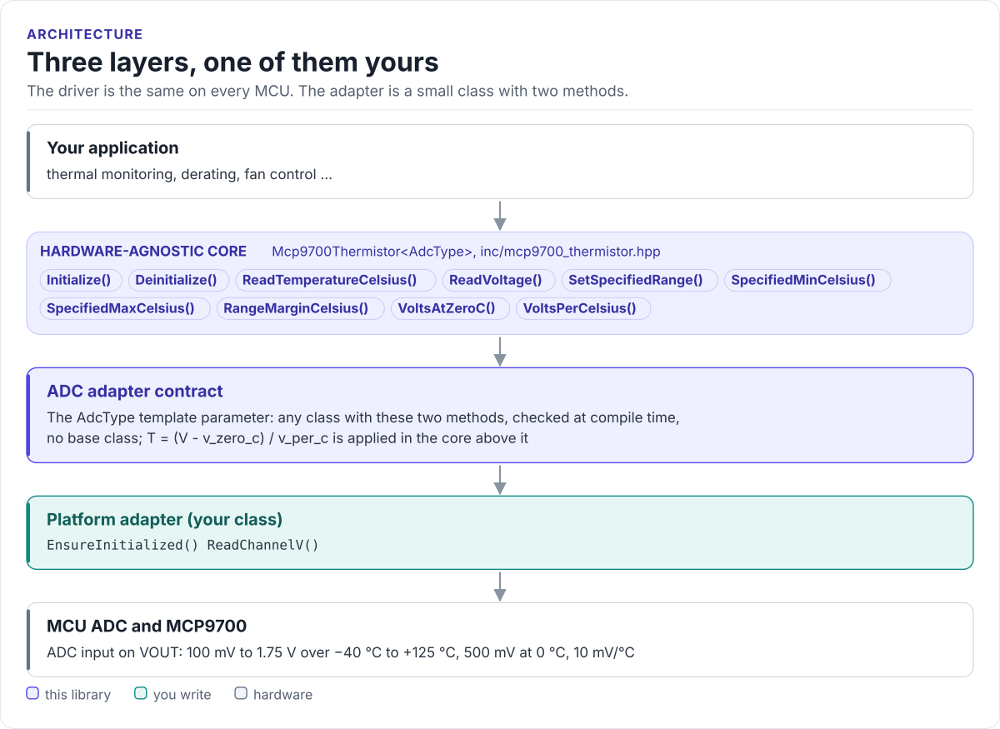
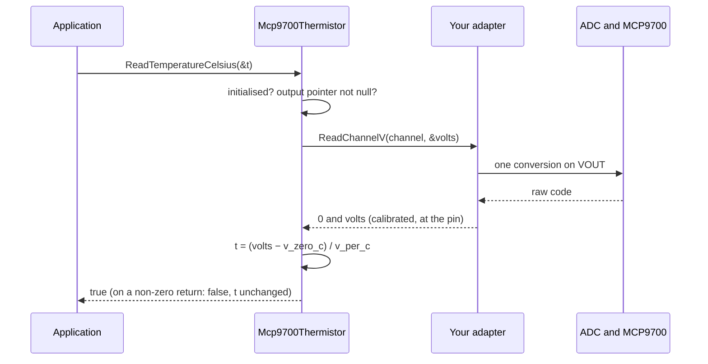

# Architecture

How the driver is put together: three layers, what each owns, and how one read reaches the sensor.

<!-- figure: driver-layers -->
<picture>
  <source media="(prefers-color-scheme: dark)" srcset="diagrams/driver-layers.dark.svg">
  
</picture>
<!-- /figure -->

## The three layers

| Layer | What it is | Changes |
| --- | --- | --- |
| **Core** | `Mcp9700Thermistor<AdcType>` | Never, for a new board |
| **Adapter contract** | The `AdcType` parameter | Never |
| **Platform adapter** | Your class, two methods | Once per MCU ([Porting](porting.md)) |

The core is in [`inc/mcp9700_thermistor.hpp`](../inc/mcp9700_thermistor.hpp) and
[`src/mcp9700_thermistor.ipp`](../src/mcp9700_thermistor.ipp); the contract is documented on the class in the same
header. Everything above the adapter is the same on ESP32, STM32, a Linux host or the unit-test mock. That is how the
[host tests](testing.md) run the real driver code without hardware.

## How one read reaches the sensor

## Why a template parameter

The adapter is a class template parameter, not a virtual base class. The compiler sees your adapter's methods
directly and inlines them; the driver has no vtable, allocates nothing and needs no RTTI. There is no base class to
derive from either: any type with the two methods compiles, and a type without them fails to compile where the
driver calls them. The cost is that the driver type names the adapter: `Mcp9700Thermistor<MyAdc>`.

## What the driver owns and what it does not

| The driver | Your adapter or application |
| --- | --- |
| The transfer function and its two coefficients | ADC set-up, channel mapping, calibration, dividers |
| The initialised state, the argument checks and the plausibility range check | Averaging, filtering, application limits |
| Returning `false` on any failure | Deciding what a failure means for your system |

The driver holds a non-owning pointer to your adapter: the adapter must outlive it. The object cannot be copied.
The constructor never touches the ADC; `Initialize()` does, through `EnsureInitialized()`.

## Source map

| Path | Contents |
| --- | --- |
| `inc/mcp9700_thermistor.hpp` | `Mcp9700Thermistor<AdcType>`, the default coefficients, `GetMcp9700DriverVersion()` |
| `src/mcp9700_thermistor.ipp` | Template implementation, included by the header |
| `inc/mcp9700_version.h.in` | Version header template, filled in by CMake |
| `cmake/hf_mcp9700_build_settings.cmake` | Version, include directories, ESP-IDF requirements |
| `tests/` | Host unit tests and the compiled documentation snippets |
| `examples/esp32/` | ESP-IDF application for the ESP32-C6 |
