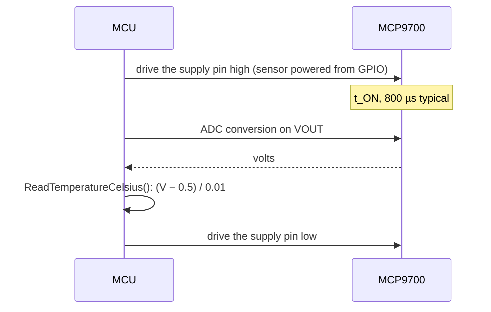

# Hardware

What to connect between your MCU and an MCP9700, how to set up the ADC, and what limits the accuracy.

All values here come from the [MCP970X family datasheet][datasheet] (DS20001942L, 2005-2024); section and table
names refer to it. The repository does not ship the PDF. Values marked derived are calculated from the datasheet,
not taken from it.

## Pins

| Signal | SOT-23, TO-92 | SC70-5 |
| --- | --- | --- |
| VDD: supply | 1 | 4 |
| VOUT: output | 2 | 3 |
| GND: ground | 3 | 2 |
| NC | | 1, 5 |

The SC70 NC pins are not connected to the die. Tie them to a copper trace from the heat source you measure for
better thermal contact.

Source: Table 3-1. The TO-92 numbering is in the bottom view of the package drawing; check your part's drawing
before you solder.

## Wiring

Connect VDD to a 2.3 V to 5.5 V rail, GND to the ADC's ground and VOUT straight to an ADC input.

The sensor needs no other parts (Section 4.3). Put the decoupling capacitor close to VDD and GND, use a ceramic
one, and keep digital lines away from the sensor.

| Situation | Recommendation |
| --- | --- |
| Normal board | 0.1 µF to 1 µF between VDD and GND |
| Noisy supply | Feed VDD through a 200 Ω resistor, with 1 µF to GND |
| Powered from an MCU pin | Decoupling capacitor and series resistor against the pin's switching noise (Section 4.2) |

The series resistor goes in the **supply** line. The datasheet asks for nothing in series with VOUT.

## Output characteristics

| Parameter | Value |
| --- | --- |
| V0°C, output at 0 °C | 500 mV typical |
| TC, coefficient | 10.0 mV/°C typical |
| Output range, −40 °C to +125 °C | 100 mV to 1.75 V |
| Nonlinearity, 0 °C to +70 °C | ±0.5 °C typical |
| Output current | 100 µA maximum |
| Output impedance | 20 Ω typical (100 µA, 500 Hz) |
| Load capacitance | 1000 pF, as characterised |
| Line regulation | 0.1 °C/V typical |

The first two rows are the driver's defaults, `kDefaultVoltsAtZeroC` and `kDefaultVoltsPerCelsius`. The output
range is from Section 3.2. The sensor is characterised and tested with 1000 pF on VOUT; it does not need the
capacitor to be stable.

The output is not ratiometric: a 3.3 V and a 5 V supply give the same voltage at the same temperature, within the
line regulation. The datasheet says added capacitance on VOUT reduces overshoot and undershoot, and that the sensor
can sit far from the MCU because it is immune to parasitic capacitance.

## ADC settings

The driver needs volts at VOUT. Set the ADC so that:

- **The full scale reaches 1.75 V.** Use the smallest range or attenuation that still covers it, to keep the
  most codes per degree.
- **The reading is calibrated.** Apply your MCU's ADC calibration in the adapter; the ADC's own offset and gain
  error adds to the sensor's.
- **Dividers are undone.** If VOUT goes through a divider or buffer with gain, the adapter scales back to the pin
  voltage.

| ADC | 1 LSB | Resolution |
| --- | --- | --- |
| 8-bit, 2.5 V reference | 9.8 mV | About 1 °C per code (datasheet) |
| 10-bit, 3.3 V reference | 3.2 mV | 0.32 °C per code (derived) |
| 12-bit, 3.3 V reference | 0.81 mV | 0.08 °C per code (derived) |
| 12-bit, 4.096 V reference | 1.0 mV | 0.1 °C per code (datasheet) |

A finer ADC does not make the sensor more accurate; it lets you see small changes. See
[Transfer function](transfer-function.md) for the error budget.

## Timing

| Parameter | Typical |
| --- | --- |
| Turn-on time, tON | 800 µs |
| Thermal response to 63 %, SC70-5 on a 1 in × 1 in copper board | 1.3 s |
| Thermal response to 63 %, TO-92-3 leaded, without a board | 1.65 s |

The thermal response is measured from air at 30 °C into a fluid bath at +125 °C. The turn-on time matters when you
power the sensor from an MCU pin: wait before the first read. The datasheet gives no maximum turn-on time; leave
margin. Reading faster than the thermal response does not follow temperature faster; average instead
([API guide](api-guide.md#average-several-reads)).

## Accuracy

| Part | 0 °C to +70 °C | −40 °C to +125 °C |
| --- | --- | --- |
| MCP9700 | ±4.0 °C | −4.0 °C to +6.0 °C |
| MCP9700A | ±2.0 °C | −2.0 °C to +4.0 °C |
| MCP9700B | ±1.0 °C (+20 °C to +70 °C) | −2.0 °C to +4.0 °C |

Limits are minimum and maximum, tested at VDD = 3.3 V, with the first-order equation (DC Electrical
Characteristics). A one-point calibration at +25 °C gives ±0.5 °C typical from 0 °C to +70 °C (Section 4.1); see
[Configuration](configuration.md#one-point-calibration).

The sensor measures the temperature of its die, which follows the board through the pins more than the air
around it (Section 4.4). Use the TO-92 package to measure air temperature. Self-heating is small: 0.179 °C in the
datasheet's worst case (5.5 V, 12 µA, 100 µA output load, SC70).

## Power and temperature

| Parameter | Value |
| --- | --- |
| Supply voltage | 2.3 V to 5.5 V; absolute maximum 6.0 V |
| Supply current | 6 µA typical, 12 µA maximum; 15 µA maximum at +150 °C |
| Operating range | −40 °C to +125 °C (extended temperature, E) |
| High-temperature range | −40 °C to +150 °C: MCP9700 and MCP9700B in SOT-23-3 and SC70-5 only |

The MCP9701 and MCP9701A in the same datasheet need 3.1 V to 5.5 V and have other coefficients; see
[Configuration](configuration.md#other-parts-of-the-family).

## Reference documents

| Document | What it is for |
| --- | --- |
| [MCP970X family datasheet][datasheet] | Pins, electrical characteristics, accuracy, application notes |
| [MCP9700 product page](https://www.microchip.com/en-us/product/MCP9700) | Ordering codes, packages, documents |
| [MCP9700A product page](https://www.microchip.com/en-us/product/MCP9700A) | The same for the A grade |
| AN1001, "IC Temperature Sensor Accuracy Compensation with a PIC Microcontroller" (DS00001001) | Nonlinearity compensation to ±0.5 °C typical over the range |

[datasheet]: https://ww1.microchip.com/downloads/aemDocuments/documents/MSLD/ProductDocuments/DataSheets/MCP970X-Family-Data-Sheet-DS20001942.pdf
