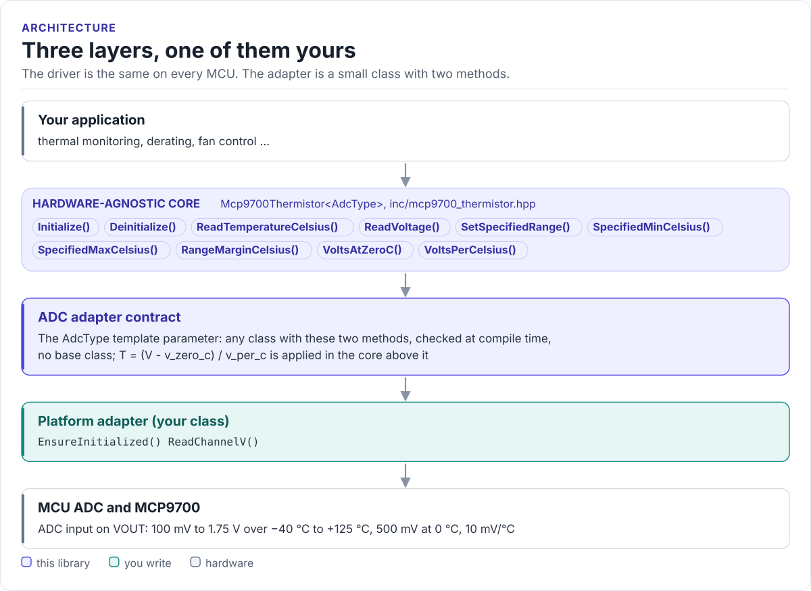

# Porting

Run the driver on a new MCU by writing one class: the ADC adapter.

The driver never calls your SDK directly. It calls two methods on the class you pass as the `AdcType` template
parameter (documented on `Mcp9700Thermistor` in [`inc/mcp9700_thermistor.hpp`](../inc/mcp9700_thermistor.hpp)).
There is no base class: the calls are resolved at compile time, so there are no virtual functions, no vtable and
nothing to allocate.

<!-- figure: driver-layers -->
<picture>
  <source media="(prefers-color-scheme: dark)" srcset="diagrams/driver-layers.dark.svg">
  
</picture>
<!-- /figure -->

## What you implement

Both are `noexcept`; the [adapter below](#the-adapter) shows the exact signatures.

| Method | Contract |
| --- | --- |
| `EnsureInitialized()` | Bring the ADC up; return `true` when it can read. Called by every `Initialize()` |
| `ReadChannelV()` | One reading of `channel`, in volts at the sensor pin, into `*voltage_v`; return `0` on success, anything else on failure |

`ReadChannelV()` returns an `int` where 0 is success, so an adapter can return the value of an error enum whose
success value is 0. The driver only tests it against zero.

## The adapter

```cpp title="my_adc.hpp"
--8<-- "tests/docs/my_adc.hpp:port"
```

Rules the adapter must follow:

- **Volts, at the pin.** Not millivolts, not raw codes. Undo any divider, attenuator or amplifier gain.
- **Calibrated.** Apply your ADC's calibration (offset, gain, curve) before returning.
- **Idempotent initialisation.** `EnsureInitialized()` may be called once per sensor and again after
  `Deinitialize()`; set the ADC up only the first time.
- **Fail loudly.** Return non-zero when the conversion fails or the channel is unknown; the driver then leaves the
  caller's value untouched. Do not write `*voltage_v` on failure.
- **One channel, one sensor.** The channel number is yours to define: an ADC channel, a multiplexer input or an
  index into a table.

## Reference implementation

The ESP32-C6 example's `Esp32Mcp9700Adc` in
[`mcp9700_esp32c6_example.cpp`](../examples/esp32/main/mcp9700_esp32c6_example.cpp) is a complete adapter over
ESP-IDF `adc_oneshot`: `ADC_UNIT_1`, `ADC_CHANNEL_0` (GPIO0), 12-bit, with curve-fitting calibration when the
chip supports it. Start from it for any ESP-IDF target.

## Check your adapter

1. Build it: the adapter on this page is compiled by the host CI from
   [`tests/docs/my_adc.hpp`](../tests/docs/my_adc.hpp), with the driver instantiated over it.
2. Measure VOUT with a multimeter and compare it with what `ReadChannelV()` returns. They should agree within
   your ADC's error.
3. At room temperature, `ReadTemperatureCelsius()` should report roughly +20 °C to +30 °C (VOUT about 0.7 V to
   0.8 V).
4. Touch the sensor: the reading should rise within a few seconds.

## Threads

The driver is not thread-safe. Give each sensor one owner task, or guard every call on a driver object (and its
adapter) with one mutex. Sensors that share an ADC share its lock too.

## Next

[Testing and CI](testing.md) shows how the adapter and driver are tested without hardware.
